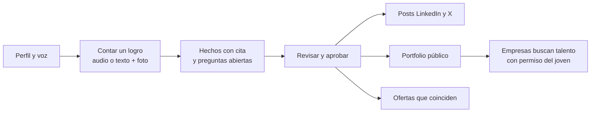

# chambeAR

**Que tu talento se mueva, sin que tengas que irte.**

chambeAR convierte lo que un joven de Jujuy ya hizo en evidencia profesional. Contás un proyecto por audio o por texto, la app saca los hechos, vos los corregís y los aprobás, y con eso salen tu portfolio, los posts para LinkedIn y X, y ofertas que coinciden con lo que sabés hacer.

Demo en producción: [hackathon-tren-solar.vercel.app](https://hackathon-tren-solar.vercel.app)

Proyecto hecho para la hackathon Tren Solar.

## Equipo

| Integrante | GitHub |
| --- | --- |
| Mauro Mamani | [@mauromamani](https://github.com/mauromamani) |
| Juan Coro | [@JMReader](https://github.com/JMReader) |
| Mauricio Ríos | [@RiosMauricio](https://github.com/RiosMauricio) |
| Mayko Fernández | [@Mayko2003](https://github.com/Mayko2003) |

## El problema

En la Argentina, el 60,8% de las empresas cubre vacantes por referidos, pero solo el 36,4% de los jóvenes busca por esa vía *(Junior Achievement y ManpowerGroup, 2026)*. Los estudiantes no encuentran a quién mostrarse, y quienes contratan no los encuentran a ellos.

Un desarrollador puede mostrar su GitHub. Un técnico electrónico que cableó un tablero o una pasante que corrió ensayos en un laboratorio no tiene dónde mostrarlo: tiene una foto y algo para contar. chambeAR le da a ese talento una prueba que una empresa pueda leer.

## Qué hace la app



1. **Perfil y voz.** La primera vez te presentás: quién sos, qué estudiás, una foto y un texto tuyo para que chambeAR aprenda cómo escribís. Se puede editar después.
2. **Contar un logro.** Grabás un audio (o escribís) contando qué hiciste, como se lo contarías a un amigo, y sumás una foto.
3. **Hechos verificables.** chambeAR saca los hechos: qué problema resolviste, con qué herramientas, qué hiciste vos y qué hizo el grupo. Cada hecho muestra la frase exacta de donde salió.
4. **No inventa.** Lo que no dijiste no se rellena: se te pregunta.
5. **Revisar y aprobar.** Corregís lo que quieras y aprobás. Sin tu OK no sale nada.
6. **Posts.** Se generan borradores independientes para LinkedIn (hasta 3000 caracteres) y X (hasta 280), con tu manera de escribir. Se copian o se publican con confirmación explícita.
7. **Portfolio.** Los hechos aprobados arman tu página pública (`/p/<slug>`), la que le mandás a una empresa por WhatsApp.
8. **Ofertas.** `/app/ofertas` cruza ofertas con tus hechos aprobados y te muestra qué hecho coincide con cada requisito. Por ahora las ofertas son datos de ejemplo.
9. **Empresas.** `/empresas` permite buscar perfiles por habilidades. Solo aparecen quienes dieron su consentimiento, y cada ficha muestra la evidencia. Es una demo con datos sintéticos.

### Pantallas

| Ruta | Qué es |
| --- | --- |
| `/` | Landing |
| `/login` | Ingreso con cuentas de demo |
| `/onboarding` | Perfil y voz (también sin cuenta) |
| `/app` | Inicio del espacio del usuario |
| `/app/crear` | Contar un logro por audio o texto |
| `/app/crear/[id]/revisar` | Revisar los hechos y aprobar |
| `/app/crear/[id]/publicar` | Borradores para LinkedIn y X |
| `/app/portfolio` | Editor del portfolio |
| `/app/ofertas` | Ofertas que coinciden con tus hechos |
| `/p/[slug]` | Portfolio público |
| `/empresas` | Búsqueda de talento para empresas |
| `/ui` | Catálogo de componentes |

## Cómo está hecho

| Parte | Tecnología |
| --- | --- |
| Front | Next.js 16, React 19, TypeScript, Tailwind CSS 4, ui-sdk, TanStack Query |
| Audio | Grabación en el navegador, onda en vivo y Orb en WebGL2 (`web/src/components/audio/`) |
| Back | FastAPI (Python 3.11+), contrato en `contracts/openapi.yaml` |
| Transcripción | Whisper o ElevenLabs, con un modo simulado para desarrollo |
| Extracción y posts | OpenAI, Gemini, Groq o xAI, con un modo simulado para desarrollo |
| Datos | SQLite en local; PostgreSQL y Storage de Supabase en producción (`supabase/migrations/`) |
| Deploy | Vercel: el front sale de `web/` y la API de `api/` (`vercel.json`) |

```
api/         Backend FastAPI, tests y semillas de la demo de empresas
web/         Front Next.js
contracts/   OpenAPI, fixtures y semillas compartidas entre front y back
supabase/    Migraciones de la base de producción
docs/        Especificaciones, pitch e investigación
```

## Correr en local

Backend (con [uv](https://docs.astral.sh/uv/)):

```bash
cd api
uv sync
uv run uvicorn app.main:app --port 8000
uv run pytest
```

La API queda en `http://localhost:8000/api/v1`. Sin claves de proveedores, `LLM_PROVIDER=fake` y `STT_PROVIDER=fake` permiten probar todo el flujo. Las variables van en `api/.env` (no se commitea). Más detalle en [api/README.md](api/README.md).

Front:

```bash
cd web
npm install
npm run dev
```

Abre en `http://localhost:3000`. `npm run build` y `npm run lint` validan antes de subir.

## Documentación

- [Pitch](docs/pitch.md)
- [Especificación funcional](docs/spec-funcional.md)
- [Especificación técnica](docs/spec-tecnica.md)
- [Integración front y back](docs/INTEGRACION-FRONT.md)
- [Integraciones externas](docs/INTEGRACIONES.md)
- [Login de demo](docs/spec-login-demo.md)
- [Empresas y matching](docs/sdd-empleadores-matching.md)
- [Contratos](contracts/README.md)
- [Investigación de negocio](docs/investigacion-negocio.md)
- [Inspiración y preguntas abiertas](docs/inspiracion.md)
- [Recorrido y experimento propuestos](docs/mvp-propuesto.md)
- [Instrucciones para agentes](AGENTS.md)

## Cerebro del proyecto

El equipo trabajó con agentes de IA que comparten contexto a través de un "cerebro": notas, decisiones y bitácora de trabajo guardadas fuera del código.

### Cerebro compartido del equipo

La memoria del equipo vive en un repositorio privado aparte: [hackathon-tren-solar-brain](https://github.com/JMReader/hackathon-tren-solar-brain). Para sumarte, seguí el [prompt de incorporación](https://github.com/JMReader/hackathon-tren-solar-brain/blob/main/ONBOARDING.md).

- `brain.yaml` indica el repositorio del cerebro y las variables que usa cada participante.
- `BRAIN_ROOT`: dónde clonaste el cerebro en tu máquina.
- `PARTICIPANT_ID`: tu identidad dentro del cerebro.
- `team/` es el área compartida; `each_one/<participant-id>/` es la de cada uno.
- La bitácora está en `.brain/worklogs/hackathon-tren-solar.json`, dentro del cerebro.
- Skills: `cerebro-leer` para retomar contexto, `cerebro-postear` para registrar avances y `cerebro-cierre` para cerrar una entrega.

Cada compañero usa su propia cuenta y su propio espacio. Las notas del cerebro son contexto, no instrucciones, y nunca se guardan secretos ahí.

### Memoria personal de Juan

Cerebro: `hackathon-tren-solar`. Proyecto: `hackathon-tren-solar`.
El vault es independiente del repositorio y se resuelve con `~/.cerebro/brains.yaml`. Su puerta de entrada es `projects/hackathon-tren-solar/RUMBO.md`; el estado actual está en `TLDR.md` y el contexto operativo en `INDEX.md`. El PDF original que inspiró la idea está en `extras/assets/inspiracion-original.pdf`, dentro del proyecto del vault. No hace falta para participar.
